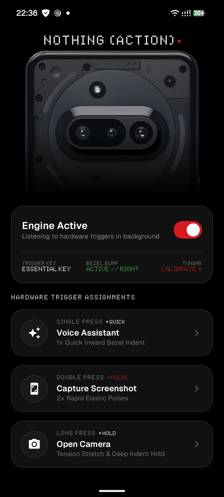

# NOTHING (ACTION) // ESSENTIAL BUTTON ENGINE

<div align="center">



[-red.svg?style=for-the-badge&logo=android)](https://www.android.com/)
[-black.svg?style=for-the-badge&logo=android)](https://developer.android.com/)
[-7F52FF.svg?style=for-the-badge&logo=kotlin)](https://kotlinlang.org/)
[](https://developer.android.com/jetpack/compose)
[](https://nothing.tech)

> **Monochrome Aesthetic • NDot 57 Typography • Bento Grid • iOS 18-Style Tactile Bezel Bump • Nothing Glyph Interface Binder**

</div>

---

## Overview

**Nothing Action** is a native Android engine designed specifically for **Nothing Phone** smartphones equipped with the dedicated physical **Essential Key** (ScanCode 250) and hardware action buttons.

It enables high-speed hardware key remapping with 3 distinct trigger modes (`Single Press`, `Double Press`, `Long Press`), authentic Nothing OS Bento Grid aesthetics, direct hardware **Glyph Interface** pulse synchronization, and mechanical **iOS 18-style tactile bezel bump animations**.

---

## Key Features

### 1. Hardware Essential Key Detection (ScanCode 250)
- Low-level physical hardware interceptor for Nothing's dedicated **Essential Key** (`scanCode = 250`).
- Smart multi-press state machine:
  - `Single Press` (Quick trigger)
  - `Double Press` (Pulse sequence)
  - `Long Press` (Hold with tension feedback)
- Zero touch interference — trusted system accessibility layer (`TYPE_ACCESSIBILITY_OVERLAY`).

### 2. Supported Actions
- ⚡ **Flashlight Toggle** (`Rear LED Torch via CameraManager`)
- 📷 **Instant Viewfinder** (`Camera launch`)
- 🎙️ **Voice Assistant** (`Google Assistant speech recognition hands-free`)
- 📸 **Screen Capture** (`Accessibility Global Action screenshot`)
- 💡 **Nothing Glyph Interface Pulse** (`Real hardware LED matrix control`)
- 🚀 **Custom App Launcher** (`Launch any installed Android package`)

### 3. iOS 18-Style Tactile Bezel Button Animation
- **100% Solid Opaque OLED Black (`#000000`)** mechanical button protrusion bump along the screen edge.
- Smooth Bézier capsule geometry simulating a physical button pressing into the display.
- Fully customizable via **Settings**:
  - Edge selection (`Right Bezel` vs `Left Bezel`)
  - Vertical alignment slider (15% to 85% of screen height)
  - Button length (height) & bump protrusion depth (width)
  - Instant live test button directly on screen.

### 4. Direct Nothing Glyph Interface Integration
- Built-in binder client connecting directly to `com.nothing.thirdparty.GlyphService` (`IGlyphService`).
- Uses official transaction protocol (`registerSDK`, `openSession`, `setFrameColors`, `setMatrixColors`).
- Physical Glyph LEDs illuminate in rhythm when triggers fire.

### 5. Authentic Nothing OS & Glyphify Design System
- Free-standing high-resolution device renders sourced from official Glyphify assets.
- Auto-detection of device color (`Dark`, `White`, `Blue`).
- True OLED Black `#000000`, card surfaces `#111111`, borders `#262626`, Nothing Red `#D71920`.
- Authentic **NDot 57** dot-matrix brand typography with full Latin and Cyrillic support.
- Balanced Bento Grid tiles with equal-height symmetrical layouts.

---

## Supported Devices

| Device | Codename | Glyph LEDs | Dedicated Essential Key |
|---|---|:---:|:---:|
| **Nothing Phone (3a)** | `ASTEROIDS` | 36 LEDs | ✅ |
| **Nothing Phone (3a) Pro** | `ASTEROIDS PRO` | 36 LEDs | ✅ |
| **Nothing Phone (3a) Lite** | `ASTEROIDS LITE` | 26 LEDs | ✅ |
| **Nothing Phone (3)** | `METROID` | 625 Dots (Matrix) | ✅ |
| **Nothing Phone (4a) & (4a) Pro** | `TETRIS` | 6 / 169 LEDs | ✅ |
| **Nothing Phone (2a) & (2a) Plus** | `PACMAN` | 26 LEDs | Hardware Keys |
| **Nothing Phone (2)** | `PONG` | 33 LEDs | Hardware Keys |
| **Nothing Phone (1)** | `SPACEWAR` | 15 LEDs | Hardware Keys |

---

## Architecture & Tech Stack

```
NothingAction/
├── app/
│   ├── src/main/
│   │   ├── java/com/nothing/action/
│   │   │   ├── MainActivity.kt                  # Single Activity Compose NavHost
│   │   │   ├── NothingActionApp.kt              # App initialisation & service bootstrap
│   │   │   ├── core/
│   │   │   │   ├── data/
│   │   │   │   │   └── ActionPreferencesRepository.kt # Jetpack DataStore Preferences
│   │   │   │   └── model/
│   │   │   │       ├── ActionType.kt            # Available triggers and actions
│   │   │   │       ├── PressType.kt             # Single, Double, Long press types
│   │   │   │       └── DeviceModel.kt           # Nothing device model detector
│   │   │   ├── glyph/
│   │   │   │   └── NothingGlyphController.kt    # Direct Binder client to Nothing Glyph service
│   │   │   ├── service/
│   │   │   │   ├── NothingAccessibilityService.kt # Hardware key event filter (ScanCode 250)
│   │   │   │   ├── NothingForegroundService.kt  # Keep-alive notification service
│   │   │   │   └── ActionExecutor.kt            # Execution engine (Assistant, Torch, Camera)
│   │   │   ├── overlay/
│   │   │   │   ├── BezelBendView.kt             # iOS 18-style mechanical bump canvas
│   │   │   │   └── BezelBendOverlayManager.kt   # WindowManager overlay lifecycle
│   │   │   └── ui/
│   │   │       ├── home/ (HomeScreen, HomeViewModel)
│   │   │       ├── onboarding/ (OnboardingScreen)
│   │   │       ├── settings/ (SettingsScreen)
│   │   │       ├── about/ (AboutScreen)
│   │   │       ├── components/ (DeviceVisualizer, BentoCard, DotMatrixHeader)
│   │   │       └── theme/ (Color, Theme, Type)
│   │   └── res/                                 # Drawables, NDot 57 fonts, configs
│   └── build.gradle.kts
└── gradle/
    └── libs.versions.toml                       # Version Catalog
```

---

## Build & Installation

### Prerequisites
- **Android Studio Ladybug (2024.2+)** or newer
- **JDK 21**
- **Android SDK 35**

### Build via Command Line
```bash
# Clone the repository
git clone https://github.com/Durhol/NothingAction.git
cd NothingAction

# Compile debug APK
./gradlew assembleDebug

# Run unit tests
./gradlew test
```

The compiled APK will be located at:
`app/build/outputs/apk/debug/app-debug.apk`

### Install to device via ADB
```bash
adb install -r app/build/outputs/apk/debug/app-debug.apk
```

---

## Permissions Setup

After the first launch, complete the quick 3-step setup wizard:
1. **Accessibility Service**: Required to intercept physical hardware clicks (ScanCode 250).
2. **Display Overlay**: Required to render the tactile mechanical bezel button bump animation.
3. **Battery Optimization Exemption**: Prevents Android from killing the background listener in Doze mode.

---

## Developer & Community

- **Developer**: [@Tyxap](https://t.me/Tyxap) on Telegram
- **GitHub**: [github.com/Durhol/NothingAction](https://github.com/Durhol/NothingAction)

---

## License

This project is licensed under the [MIT License](LICENSE).
Nothing, Nothing Phone, Glyph Interface, and Nothing OS are trademarks of Nothing Technology Limited.
