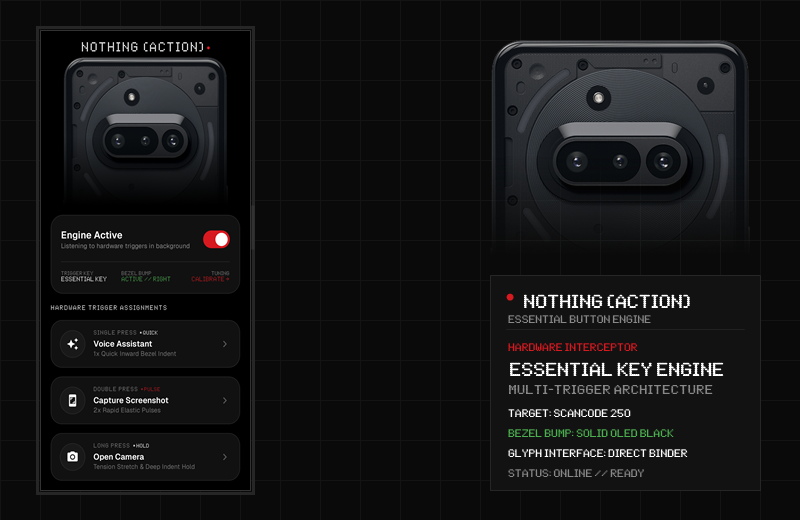

# NOTHING (ACTION) // ESSENTIAL BUTTON ENGINE

<div align="center">



<br/>

[-111111?style=for-the-badge&logo=android&logoColor=white)](https://www.android.com/)
[-000000?style=for-the-badge&logo=android&logoColor=D71920)](https://developer.android.com/)
[-1A1A1A?style=for-the-badge&logo=kotlin&logoColor=white)](https://kotlinlang.org/)
[](https://developer.android.com/jetpack/compose)
[-D71920?style=for-the-badge&logo=nothing&logoColor=white)](https://nothing.tech)

**Monochrome Aesthetic • NDot 57 Typography • Bento Grid • iOS 18-Style Tactile Bezel Bump • Direct Glyph Interface Binder**

</div>

---

## 01 // OVERVIEW

**Nothing Action** is a specialized native Android engine created for **Nothing Phone** devices equipped with the dedicated physical **Essential Key** (`ScanCode 250`) and remappable hardware action buttons.

It replaces standard button limitations with high-speed, multi-tier hardware trigger detection (`Single Press`, `Double Press`, `Long Press`), authentic Nothing OS Bento Grid aesthetics, a physical **iOS 18-style mechanical bezel button protrusion**, and direct low-level **Nothing Glyph Interface** hardware synchronization.

---

## 02 // HARDWARE INTERCEPTOR & ACTIONS

### Physical Trigger Mapping (ScanCode 250)
- Low-level kernel scan-code listener for Nothing's dedicated **Essential Key** (`scanCode = 250`).
- Multi-click state machine with micro-second resolution:
  - `SINGLE PRESS` • Quick execution trigger (280ms resolution window)
  - `DOUBLE PRESS` • Rapid dual-pulse trigger
  - `LONG PRESS` • Hold and tension stretch trigger

### Action Matrix
- `[TORCH]` • Instant rear LED flashlight toggle via `CameraManager`
- `[CAMERA]` • Rapid viewfinder launch with lock-screen bypass
- `[ASSISTANT]` • Google Voice Assistant speech recognition (`HandsFreeActivity` prompt)
- `[SCREENSHOT]` • Instant screen capture via Accessibility global action
- `[GLYPH]` • Physical rear Glyph LED interface synchronized rhythm pulse
- `[CUSTOM_APP]` • Launch any user-selected third-party application package

> **Essential Key Remapping Guide**: Need to disable or customize the default Nothing OS Essential Space behavior? Check out the community guide by [@z3phydev](https://github.com/z3phydev): [How-to-remap-or-disable-the-Essential-Key](https://github.com/z3phydev/How-to-remap-or-disable-the-Essential-Key).

---

## 03 // MECHANICAL BEZEL BUTTON ANIMATION (iOS 18 STYLE)

- **100% Solid Opaque OLED Black (`#000000`)**: Zero translucency, zero borders, zero background dimming.
- **Physical Mechanical Capsule Geometry**: A rounded pill-shaped button protrusion expanding out from the bezel into the display using cubic Bézier curves and spring-back physics (`OvershootInterpolator`).
- **Trusted System Layer**: Renders through `TYPE_ACCESSIBILITY_OVERLAY`, bypassing Android's untrusted overlay opacity filters on both the home screen (wallpaper) and the lock screen.
- **Dynamic Lifecycle**: Window attaches strictly during the 300ms press animation and detaches immediately on completion, preventing any touch screen interference.
- **Full Calibration Controls**:
  - Edge selection (`RIGHT BEZEL` / `LEFT BEZEL`)
  - Vertical alignment slider (15% to 85% of screen height)
  - Button length (height) & bump protrusion depth (width)
  - Instant live test execution button

---

## 04 // DIRECT NOTHING GLYPH BINDER INTEGRATION

Direct client implementation connecting to the privileged system broker:
```
Service:    com.nothing.thirdparty.GlyphService
Action:     com.nothing.thirdparty.bind_glyphservice
Interface:  com.nothing.thirdparty.IGlyphService
Permission: com.nothing.ketchum.permission.ENABLE (normal)
```

- Drives LED brightness channels (0–4096 scale) via Transaction 1 (`setFrameColors`) and Transaction 7 (`setMatrixColors`).
- Authenticates without proprietary API keys on modern Nothing OS builds.
- Synchronizes tactile vibration waveforms with physical LED animations.

---

## 05 // COMPATIBILITY MATRIX

| Model | Codename | Glyph LEDs | Dedicated Essential Key | Primary Trigger |
|---|---|:---:|:---:|---|
| **Nothing Phone (3a)** | `ASTEROIDS` | 36 LEDs | YES | `ScanCode 250` (Essential) |
| **Nothing Phone (3a) Pro** | `ASTEROIDS PRO` | 36 LEDs | YES | `ScanCode 250` (Essential) |
| **Nothing Phone (3a) Lite** | `ASTEROIDS LITE` | 26 LEDs | YES | `ScanCode 250` (Essential) |
| **Nothing Phone (3)** | `METROID` | 625 Dots (Matrix) | YES | `ScanCode 250` / Action |
| **Nothing Phone (4a) & (4a) Pro** | `TETRIS` | 6 / 169 LEDs | YES | `ScanCode 250` / Action |
| **Nothing Phone (2a) & (2a) Plus** | `PACMAN` | 26 LEDs | NO | Hardware Keys |
| **Nothing Phone (2)** | `PONG` | 33 LEDs | NO | Hardware Keys |
| **Nothing Phone (1)** | `SPACEWAR` | 15 LEDs | NO | Hardware Keys |

---

## 06 // ARCHITECTURE & MODULES

```
NothingAction/
├── app/
│   ├── src/main/
│   │   ├── java/com/nothing/action/
│   │   │   ├── MainActivity.kt                # Edge-to-Edge Compose NavHost
│   │   │   ├── NothingActionApp.kt            # App bootstrap & foreground service starter
│   │   │   ├── core/
│   │   │   │   ├── data/
│   │   │   │   │   └── ActionPreferencesRepository.kt # Reactive DataStore settings
│   │   │   │   └── model/
│   │   │   │       ├── ActionType.kt          # Action definitions & executor dispatch
│   │   │   │       ├── PressType.kt           # SINGLE, DOUBLE, LONG definitions
│   │   │   │       └── DeviceModel.kt         # Hardware model detector (A059, A142, A065...)
│   │   │   ├── glyph/
│   │   │   │   └── NothingGlyphController.kt  # Direct AIDL binder client to GlyphService
│   │   │   ├── service/
│   │   │   │   ├── NothingAccessibilityService.kt # Kernel key interceptor (ScanCode 250)
│   │   │   │   ├── NothingForegroundService.kt # FGS with quick status notification
│   │   │   │   └── ActionExecutor.kt          # Assistant, torch, camera execution engine
│   │   │   ├── overlay/
│   │   │   │   ├── BezelBendView.kt           # iOS 18 mechanical button bump canvas
│   │   │   │   └── BezelBendOverlayManager.kt # Trusted accessibility overlay lifecycle
│   │   │   └── ui/
│   │   │       ├── home/                      # Free-standing Glyphify hero & Bento grid
│   │   │       ├── onboarding/                # 3-step setup & key detector wizard
│   │   │       ├── settings/                  # Hardware calibration & permission checks
│   │   │       ├── about/                     # Ecosystem notes & developer links
│   │   │       ├── components/                # BentoCard, DotMatrixHeader, ActionPicker
│   │   │       └── theme/                     # Pure OLED Black, Nothing Red, NDot 57
│   │   └── res/                               # Glyphify device assets, NDot OTF fonts
│   └── build.gradle.kts
└── gradle/
    └── libs.versions.toml                     # Dependency version catalog
```

---

## 07 // BUILD & DEPLOYMENT

### Prerequisites
- JDK 21
- Android SDK 35 (Android 15)
- Gradle 8.9 + AGP 8.7.2

### Compile Debug APK
```bash
# Clone the repository
git clone https://github.com/Durhol/NothingAction.git
cd NothingAction

# Assemble APK
./gradlew assembleDebug

# Run unit tests
./gradlew test
```

The APK binary will be output to:
`app/build/outputs/apk/debug/app-debug.apk`

### Install to Device via ADB
```bash
adb install -r app/build/outputs/apk/debug/app-debug.apk
```

---

## 08 // FIRST LAUNCH SETUP

1. **Accessibility Service**: Enable `Nothing Action Key Interceptor` to receive hardware key events.
2. **Display Overlay**: Grant overlay permission for the mechanical bezel button bump animation.
3. **Battery Exemption**: Add to Doze mode exemption list for uninterrupted background operation.
4. **Key Calibration**: Press your physical Essential Key to automatically verify ScanCode 250.

---

## 09 // DEVELOPER & CREDITS

- **Author & Developer**: [Durhol](https://github.com/Durhol)
- **Telegram**: [@Tyxap](https://t.me/Tyxap)
- **Repository**: [github.com/Durhol/NothingAction](https://github.com/Durhol/NothingAction)
- **Essential Key Guide**: [z3phydev/How-to-remap-or-disable-the-Essential-Key](https://github.com/z3phydev/How-to-remap-or-disable-the-Essential-Key)

---

## 10 // LICENSE

Licensed under the [MIT License](LICENSE).  
Nothing, Nothing Phone, Glyph Interface, and Nothing OS are trademarks of Nothing Technology Limited.
